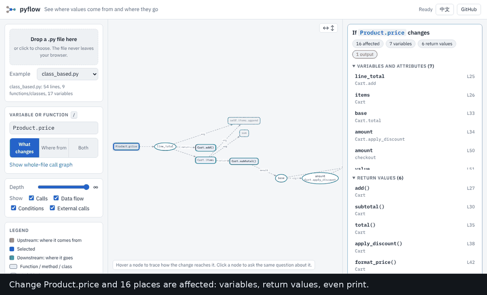

# pyflow

**If this variable changes, what else changes?**

Put the cursor on a variable, parameter, attribute or function in a Python file. pyflow marks every
place its value can reach: other variables, return values, the callers that receive them, and output
such as `print` or `write`. For each place it can show the path that leads there.

[English] · [繁體中文](README.zh-TW.md)



**Try it in your browser, nothing to install:**
[open the demo](https://archi9882.github.io/SciML/#ex=class_based.py&q=Product.price&m=impact),
then drop your own `.py` file on the page. Your file never leaves your browser.

## Two ways to use it

| | |
|---|---|
| **VS Code extension** | Marks the answer in your editor, lists it in the Explorer, explains each mark on hover. See [`vscode-impact/`](vscode-impact/README.md). |
| **Web page** | Drag a file in, click any variable in the source. `python scripts/serve.py` runs it offline. |
| **Command line** | `pyflow file.py -q price --impact` prints the answer with the reasons. |

## What it tells you

```python
def shipping(weight, express):
    if weight <= 0:
        return 0
    cost = weight * 4
    if express:
        cost = cost * 2
    print(f"shipping: {cost}")
    return cost
```

```text
$ pyflow shipping.py -q express --impact
If shipping.express changes (express (parameter in shipping)):

  3 things are affected: 1 variable, 1 return value, 1 output.
  3 of them only through a condition (if / loop / guard).

Variables and attributes that change (1):
  shipping.cost                line 6  [condition]

Functions whose return value changes (1):
  shipping()                   line 8  [condition]
      via shipping.express -> shipping.cost -> shipping()

Output and side effects that change (1):
  print                        line 7  [condition]
      via shipping.express -> shipping.cost -> print
```

No value moves from `express` into `cost`, yet changing `express` changes what is printed.
pyflow follows that: a condition counts, and is labelled as one, because it is weaker evidence than a
value that flows. Changing `weight` instead reaches `cost` through data (line 4) and through the guard
clause (line 3), and the report says so.

## What it follows

- assignments, augmented assignments, tuple unpacking, `for` variables, comprehensions, lambdas, `with ... as`
- function arguments (positional and keyword), defaults, return values, and the variables that receive them
- an object depends on its constructor arguments; `self.x` is shared between methods; dataclass fields
- inheritance and `super()` for classes defined in the same file
- values put into containers: `items.append(x)`, `d[k] = x`, `d.update(...)`
- conditions: `if` / `while` / `match` tests, loop iterables, and guard clauses (`if bad: return` guards the code after it)
- reads of module-level and enclosing-function variables

External calls (`print`, `len`, library functions) are endpoints. Values go in and are reported, but are
not followed through the library, so unrelated variables are never connected by `print`.
Output and side effects (`print`, `write`, `send`, `save`, `to_csv`, logging, ...) are listed separately.

## What it does not know (read this)

pyflow reads code; it does not run it. It says so when it cannot follow something, in the
**Not analyzed** list and as a warning on any result that touches those spots:
`*args` / `**kwargs`, decorators that may change a function, `getattr` / `exec`, `global` rebinding,
`match` patterns, `import *`.

- **One file at a time.** Imports from your other files are treated as external calls.
- **No aliasing.** After `b = a`, changing `b` in place does not mark `a`.
- **One node per attribute, not per object.** Two `Cart` objects share `Cart.items`.
- **Calls are not told apart.** If `f` is called from two places, a value passed at one appears to reach both results.
- **Dynamic behaviour is invisible.** Anything decided at run time can be missed.

Where it can, pyflow errs toward showing a possible place rather than hiding it (every argument of a
library call is assumed to reach its result, for instance). It cannot show what it cannot see, which is
why the warnings above exist. The test suite holds [hand-labelled answers](tests/test_impact.py) for each rule above, and the analyzer
has been run over the whole Python standard library (about 3,000 files) without errors.

## Command line

```bash
pip install -e .                                  # from this folder; Python 3.10+, no dependencies
pyflow file.py -q price --impact                  # what changes if `price` changes
pyflow file.py --at 12:9 --impact                 # the name at line 12, column 9 (1-based)
pyflow file.py -q price --impact --no-control     # data only, ignore conditions
pyflow file.py -q price --impact --json           # machine-readable result (used by the editor extension)
pyflow file.py -q price                           # where it comes from and where it goes
cat file.py | pyflow x.py --stdin --at 3:5 --impact
```

From Python:

```python
from pyflow import analyze, search, impact

graph = analyze(open("my_script.py").read())
node = search(graph, "price")[0]
result = impact(graph, node["id"])
print(result["summary"])           # counts by kind
for n in result["nodes"][1:]:
    print(n["category"], n["id"], n["where"], [s["to"] for s in n["path"]])
```

`result` also has `lines` (where the change arrives), `source_refs` / `affected_refs` (token positions,
0-based UTF-16 columns, as editors use), `warnings` and `truncated`.

## Run the web page locally

```bash
python scripts/serve.py
```

Builds the site, downloads the libraries it needs once (about 14 MB, checked against the npm registry's
published hashes, cached in `.vendor-cache/`), serves it at http://127.0.0.1:8000 and opens your
browser. After that it works offline.

## Development

```bash
pip install pytest
python -m pytest                       # analyzer, impact benchmark, CLI

cd vscode-impact && npm ci && npm run prepare-assets && npm test    # the editor extension
```

```
core/pyflow/     analyzer (ast -> graph), impact / search / locate, CLI, the bridge used by the web page
web/             the browser demo (Cytoscape.js + dagre)
vscode-impact/   the VS Code extension that marks the answer in the editor (TypeScript; calls the analyzer through Python)
vscode/          a second extension that shows the web page beside the editor
tests/           one small program per rule, with the expected answer worked out by hand
examples/        four styles: script, pure functions, classes, data pipeline
scripts/         vendor.py (pinned, hash-checked libraries), build_site.py, serve.py
docs/            design notes and images
```

`.github/workflows/pyflow.yml` runs the tests on Python 3.10, 3.12 and 3.13, builds the extension,
and publishes the web demo to GitHub Pages from `main`.

## Feedback

A wrong or missing result is the most useful report: send a small piece of code and what you expected.
It becomes a test. MIT licensed.
