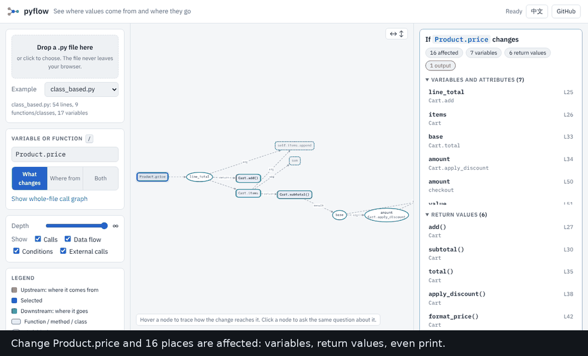

# pyflow

**如果這個變數改變，還有什麼會跟著改變？**

把游標放在 Python 檔裡的變數、參數、屬性或函式上。pyflow 會標出它的值可能到達的每個地方：
其他變數、回傳值、接收這些回傳值的呼叫者，以及 `print`、`write` 這類輸出。
每一處都能看到通往它的路徑。

[English](README.md) · [繁體中文]



**直接在瀏覽器試用，不需安裝：**
[開啟示範](https://archi9882.github.io/SciML/#ex=class_based.py&q=Product.price&m=impact)，
再把你自己的 `.py` 檔拖到頁面上。檔案不會離開你的瀏覽器。

## 三種使用方式

| | |
|---|---|
| **VS Code 擴充套件** | 在編輯器中標出答案、在檔案總管列出清單、滑過標記即可看到原因。見 [`vscode-impact/`](vscode-impact/README.md)。 |
| **網頁** | 拖入檔案，點原始碼中的任一變數。`python scripts/serve.py` 可離線執行。 |
| **命令列** | `pyflow file.py -q price --impact` 會印出答案與原因。 |

## 它會告訴你什麼

```python
def shipping(weight, express):
    if weight <= 0:
        return 0
    cost = weight * 4
    if express:
        cost = cost * 2
    print(f"shipping: {cost}")
    return cost
```

```text
$ pyflow shipping.py -q express --impact
If shipping.express changes (express (parameter in shipping)):

  3 things are affected: 1 variable, 1 return value, 1 output.
  3 of them only through a condition (if / loop / guard).

Variables and attributes that change (1):
  shipping.cost                line 6  [condition]

Functions whose return value changes (1):
  shipping()                   line 8  [condition]
      via shipping.express -> shipping.cost -> shipping()

Output and side effects that change (1):
  print                        line 7  [condition]
      via shipping.express -> shipping.cost -> print
```

沒有任何值從 `express` 傳進 `cost`，但改變 `express` 會改變印出的內容。pyflow 會追蹤這種關係：
條件也算，並且標示為條件，因為它的證據比「值的流動」弱。改看 `weight` 的話，它經由資料（第 4 行）
與守衛式提前返回（第 3 行）影響 `cost`，報告會一併說明。

## 它追蹤什麼

- 賦值、擴增賦值、解構賦值、`for` 迴圈變數、生成式、lambda、`with ... as`
- 函式引數（位置與關鍵字）、預設值、回傳值，以及接收它們的變數
- 物件取決於它的建構子引數；`self.x` 在方法之間共用；dataclass 欄位
- 同一檔案內類別的繼承與 `super()`
- 就地填入容器的值：`items.append(x)`、`d[k] = x`、`d.update(...)`
- 條件：`if`／`while`／`match` 的判斷式、迴圈的可迭代物件，以及守衛式提前返回（`if bad: return` 會影響其後的程式碼）
- 讀取模組層級與外層函式的變數

外部呼叫（`print`、`len`、函式庫函式）是終點：值會被送進去並列出，但不會穿過函式庫繼續追蹤，
所以不相關的變數不會因為都呼叫了 `print` 而被連在一起。
輸出與副作用（`print`、`write`、`send`、`save`、`to_csv`、日誌等）會另外列出。

## 它不知道什麼（請先讀這段）

pyflow 只讀程式碼、不執行。遇到無法追蹤的地方，它會說出來：列在**未分析**清單，
並在涉及這些地方的結果上附上警告：
`*args`／`**kwargs`、可能改變函式的裝飾器、`getattr`／`exec`、`global` 重新綁定、`match` 的模式、`import *`。

- **一次一個檔案。** 從你其他檔案匯入的東西視為外部呼叫。
- **不追蹤別名。** `b = a` 之後就地修改 `b`，不會標示 `a`。
- **每個屬性一個節點，不區分物件。** 兩個 `Cart` 物件共用 `Cart.items`。
- **不區分呼叫來源。** 若 `f` 在兩處被呼叫，從其中一處傳入的值看起來會流到兩處的結果。
- **看不到動態行為。** 執行時才決定的事可能被漏掉。

在可以的地方，pyflow 寧可多標一個可能的地方，也不隱藏它（例如函式庫呼叫的每個引數都假設會影響其結果）。
但它無法顯示它看不到的東西，上面的警告就是為此存在。測試中有
[手工標註的答案](tests/test_impact.py)，涵蓋上述每一項規則；分析器也已跑過整個 Python 標準函式庫
（約 3,000 個檔案），沒有出錯。

## 命令列

```bash
pip install -e .                                  # 在本資料夾執行；Python 3.10 以上，無相依套件
pyflow file.py -q price --impact                  # 如果 price 改變，會影響什麼
pyflow file.py --at 12:9 --impact                 # 第 12 行第 9 欄的名稱（從 1 起算）
pyflow file.py -q price --impact --no-control     # 只看資料，忽略條件
pyflow file.py -q price --impact --json           # 機器可讀的結果（編輯器擴充套件使用）
pyflow file.py -q price                           # 它從哪裡來、往哪裡去
cat file.py | pyflow x.py --stdin --at 3:5 --impact
```

在 Python 中使用：

```python
from pyflow import analyze, search, impact

graph = analyze(open("my_script.py").read())
node = search(graph, "price")[0]
result = impact(graph, node["id"])
print(result["summary"])           # 各類別的數量
for n in result["nodes"][1:]:
    print(n["category"], n["id"], n["where"], [s["to"] for s in n["path"]])
```

`result` 還包含 `lines`（變化到達的行）、`source_refs`／`affected_refs`（詞的位置，
欄位為從 0 起算的 UTF-16，與編輯器一致）、`warnings` 與 `truncated`。

## 在本機執行網頁

```bash
python scripts/serve.py
```

會建置網站，第一次執行時下載所需函式庫（約 14 MB，會比對 npm 公布的雜湊值，並快取在
`.vendor-cache/`），在 http://127.0.0.1:8000 啟動並開啟瀏覽器。之後不需網路也能使用。

## 開發

```bash
pip install pytest
python -m pytest                       # 分析器、影響基準、命令列

cd vscode-impact && npm ci && npm run prepare-assets && npm test    # 編輯器擴充套件
```

```
core/pyflow/     分析器（ast -> 圖）、影響／搜尋／位置反查、命令列、網頁使用的介面
web/             瀏覽器示範（Cytoscape.js + dagre）
vscode-impact/   在編輯器內標出答案的 VS Code 擴充套件（TypeScript；透過 Python 呼叫分析器）
vscode/          另一個擴充套件：在編輯器旁顯示網頁
tests/           每條規則一個小程式，預期答案由人工推導
examples/        四種風格：腳本、純函式、類別、資料管線
scripts/         vendor.py（固定版本並驗證雜湊的函式庫）、build_site.py、serve.py
docs/            設計文件與圖片
```

`.github/workflows/pyflow.yml` 會在 Python 3.10、3.12、3.13 上執行測試、建置擴充套件，
並從 `main` 發布網頁示範到 GitHub Pages。

## 回報

結果有錯或漏掉時，最有用的回報是一小段程式碼，加上你預期的結果。它會變成一個測試。MIT 授權。
