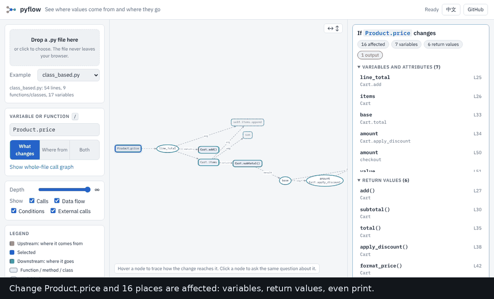

# pyflow: Change Impact for Python

**Put the cursor on a variable. See everything that changes if its value changes.**

Before you rename a parameter, change a default or fix a calculation, you want to know where it
reaches. pyflow follows the value forward through assignments, function calls, return values,
attributes, containers and conditions, and marks every place in the editor.

> The same analysis runs in the browser demo: drag a `.py` file onto the page, no install.
> 

## How to use

1. Open a Python file and put the cursor on a variable, parameter, attribute or function name.
2. Press <kbd>Ctrl</kbd>+<kbd>Alt</kbd>+<kbd>I</kbd>, or right-click and choose **pyflow: What changes if this changes?**
3. Read the answer:
   - the name you asked about is highlighted in blue
   - places the change reaches through data are green, and their lines are tinted
   - output and side effects (`print`, `write`, `send`, logging) are orange
   - places that change only through a condition are purple
4. The **pyflow impact** view in the Explorer lists everything by kind. Click an item to jump to it.
5. Hover a mark to see the path that leads to it, for example `price → line_total → Cart.items → subtotal()`.
6. **pyflow: Show impact graph** draws the same result as a diagram.

The marks describe the code as it is in the editor, including unsaved edits. If you edit the file, the
marks are cleared (their positions would be wrong), and you run the command again.

## What it understands

- assignments, augmented assignments, tuple unpacking, `for` variables, comprehensions, lambdas, `with ... as`
- function arguments (positional and keyword), defaults, return values and the variables that receive them
- `self.x` attributes shared between methods, dataclass fields, inheritance and `super()` within the file
- values put into containers: `items.append(x)`, `d[k] = x`, `d.update(...)`
- conditions: `if x: y = 1` means `x` can change `y`. Guard clauses (`if bad: return`) count for the code after them.
- reads of module-level and enclosing-function variables

## What it does not know (read this)

pyflow reads code; it does not run it. It says so when it cannot follow something: the status bar
and the view list the spots, such as `*args` / `**kwargs`, decorators, `getattr` / `exec`, and `global` rebinding.
A result near those spots may be incomplete.

- **One file at a time.** Imports from your other files are treated as external calls.
- **No aliasing.** After `b = a`, changing `b` in place does not mark `a`.
- **One node per attribute, not per object.** Two `Cart` objects share `Cart.items`.
- **A condition is not a value.** Conditional results are listed separately because they are weaker evidence.

## Requirements and privacy

- Python 3.10 or newer on your machine. pyflow uses the interpreter selected in the Python extension,
  or `python3` / `python` from PATH, or the one in the `pyflow.pythonPath` setting. Nothing is installed.
- The analysis runs locally in a short-lived Python process. Your code is never sent anywhere,
  and the extension makes no network requests.

## Settings

| Setting | Default | |
|---|---|---|
| `pyflow.pythonPath` | empty | Python used for the analysis |
| `pyflow.includeConditions` | on | follow `if` / loop conditions |
| `pyflow.maxGraphNodes` | 150 | most nodes drawn in the graph (the list and marks always cover all) |

The colors can be changed in your theme: `pyflow.sourceBackground`, `pyflow.affectedBackground`,
`pyflow.conditionBackground`, `pyflow.effectBackground`, `pyflow.lineBackground`.

## Feedback

If a result is wrong, a small snippet of code and what you expected is the most useful report.
Open an issue at https://github.com/archi9882/SciML/issues. MIT licensed.
